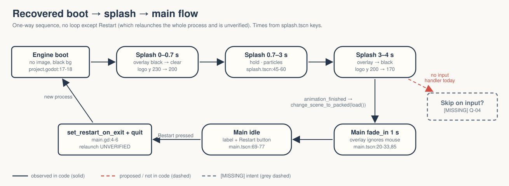
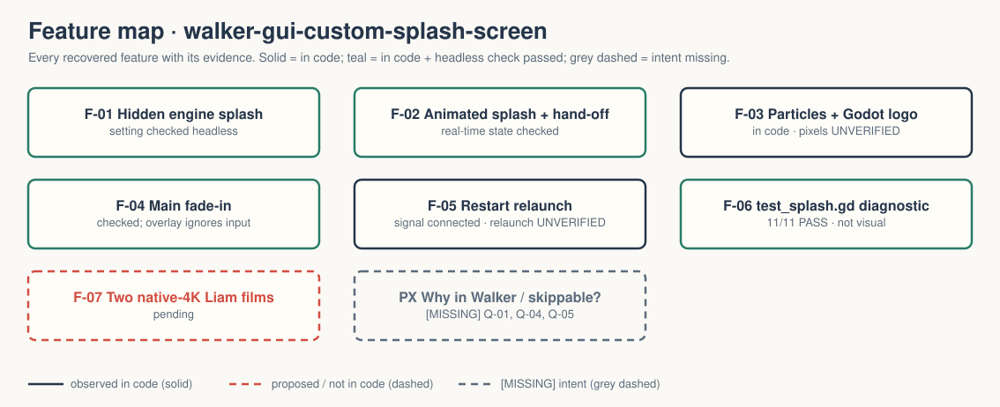

# walker-gui-custom-splash-screen — Game Design Document (recovered)

| | |
|---|---|
| Version | 0.1.0-recovered |
| Date | 2026-09-27 |
| Author | Zelda (agent, silent), for Nik Bear Brown |
| Mode | recovered — `/gdd reverse --path godot silent` |
| Revision | 1 |
| Gates | gate — unsigned at time of writing · vision ○ · systems ○ · world ○ · scope ○ |
| Source | Godot demo `gui/custom_splash_screen`, commit `a3b5c113112f77291d5f3d1360f33a882fdc52f7`; Walker change is the project title only |
| What this is | **A tech demo, not a game.** A four-second custom boot splash that hands off to a placeholder main scene. |

Provenance tags: `[OBSERVED path:line]` the code or a project file does this · `[INFERRED]` the code strongly implies this, evidence stated · `[MISSING]` nothing in the folder can tell us this; each one is an open question in `design/decisions.md`. Paths are relative to the project folder (the folder that contains `godot/`). This file is identical at `GDD.md` and `design/GDD.md`.

A recovered GDD describes what exists. It approves nothing.

Evidence image: `godot/screenshots/custom_splash_screen.webp` is the **upstream** screenshot retained with the copy `[OBSERVED README.md:3-5]`. It is not a Walker capture; splash pixels are unverified `[OBSERVED README.md:8-10]`.

## 1. Vision summary

**Logline (recovered).** "A demo showing how to create a custom splash screen scene, while hiding the default splash screen for a seamless experience." `[OBSERVED godot/README.md:3-4]`

**The trick it teaches.** The engine's own boot image is turned off and its boot background set to the same black as the splash's first frame, so the hand-off is invisible `[OBSERVED godot/project.godot:17-18; godot/README.md:20-23]`. The main scene is loaded with `load()`, not `preload()`, so the splash can appear before the main scene's assets are ready `[OBSERVED godot/splash.gd:5-6]`.

**Player fantasy / goal.** None. The viewer watches four seconds, then sees a label and a Restart button `[OBSERVED godot/main.tscn:69-77]`. There is nothing to win or lose.

**Why it is in Walker, and for whom.** `[MISSING → Q-01, Q-02]` The folder records verification and two pending films `[OBSERVED FRICTIONAL.md; README.md:8-10]`; it does not say what Walker uses a splash demo for (a pattern for Walker games' own boot? a film topic?).

**Branding.** The splash shows the retained Godot logo. The local README says explicitly that this is not Walker branding `[OBSERVED README.md:5-6]`. Whether Walker games should get their own splash art is `[MISSING → Q-05]`.

## 2. Design pillars

`[MISSING → Q-03]` None declared. The code's structure implies two technical rules `[INFERRED from godot/project.godot:17-18 and godot/splash.gd:5]`:
- **Seamless boot**: nothing visible may change between engine start and the splash's first frame.
- **Splash first, load later**: the splash never waits on the main scene's assets.

## 3. Core loop

There is no loop; there is a one-way sequence `[OBSERVED]`:
1. Engine boot: no image, black background `[godot/project.godot:17-18]`.
2. Splash (`godot/splash.tscn`, main scene by UID `[godot/project.godot:15]`), animation `splash`, 4.0 s, autoplays `[godot/splash.tscn:34-36,94]`:
   - 0–0.7 s: black overlay fades to clear, logo rises from y 230 to 200;
   - 0.7–3.0 s: hold;
   - 3.0–4.0 s: overlay back to black, logo rises to 170 `[godot/splash.tscn:45-60]`.
3. `animation_finished` → `change_scene_to_packed(load("res://main.tscn"))` `[godot/splash.tscn:150; godot/splash.gd:4-6]`.
4. Main: `fade_in` (1 s, black to clear) autoplays `[godot/main.tscn:20-33,53]`; label "Splash screen is done showing." and a Restart button `[godot/main.tscn:69-77]`.
5. Restart → `OS.set_restart_on_exit(true)` then `quit()` `[godot/main.gd:4-6; godot/main.tscn:88]`: the process relaunches and the sequence repeats. **Unverified**; the test deliberately does not press it because it starts another process `[OBSERVED FRICTIONAL.md:17-18]`.

The splash cannot be skipped: `splash.gd` has no input handler `[OBSERVED godot/splash.gd:1-6]`. Whether it should be is `[MISSING → Q-04]`.

## 4. Player Experience Goals

`[MISSING → Q-04]` None declared. The only experiential claim in the source is "a seamless experience" `[OBSERVED godot/README.md:4]`, which is a technical property, not a goal a viewer can be tested against. Seamlessness has not been checked visually `[OBSERVED FRICTIONAL.md:18-20]`.

## 5. Mechanics

Numbers are observed defaults, not approved tuning.

- **M-01 Hidden engine splash** — `boot_splash/show_image=false`, `boot_splash/bg_color` black `[OBSERVED godot/project.godot:17-18]`; checked `[OBSERVED splash-20260926.log]`.
- **M-02 Splash animation** — 4.0 s, step 0.1, logo position and overlay color tracks, keys at 0 / 0.7 / 3 / 4 s `[OBSERVED godot/splash.tscn:34-61]`.
- **M-03 Particle backdrop** — CPUParticles2D: 40 particles, lifetime 3 s, preprocess 3 s, rectangle emission 576×324 extents at (576, 324), radial acceleration 40, 6-frame flipbook, dark-blue tint, alpha ramp in and out `[OBSERVED godot/splash.tscn:69-81,105-124]`. Appearance **unverified** `[OBSERVED README.md:8-9]`.
- **M-04 Logo** — `logo_large_color_dark.svg` in a centered TextureRect `[OBSERVED godot/splash.tscn:126-139]`.
- **M-05 Deferred main load** — `load()` inside the `animation_finished` handler `[OBSERVED godot/splash.gd:4-6]`.
- **M-06 Main fade-in** — 1 s overlay fade; overlay ignores mouse input (`mouse_filter = 2`) so the button is clickable during the fade `[OBSERVED godot/main.tscn:20-33,85]`.
- **M-07 Restart** — button relaunches the whole process `[OBSERVED godot/main.gd:4-6]`.

## 6. Systems

- **S-01 Scene flow.** Two scenes, one direction, one transition by `change_scene_to_packed` `[OBSERVED godot/splash.gd:6]`. No autoload, no scene manager.
- **S-02 Animation.** Two AnimationPlayers with `RESET` + one clip each `[OBSERVED godot/splash.tscn:63-67; godot/main.tscn:36-40]`.
- **S-03 Input.** No `[input]` section; only the Restart button's `pressed` signal `[OBSERVED godot/project.godot; godot/main.tscn:88]`.
- **S-04 Save/load.** None.
- **S-05 Display.** `canvas_items` stretch; no window size set, so Godot's default applies `[OBSERVED godot/project.godot:20-22]`. The particle emission rectangle matches a 1152×648 area `[INFERRED — extents 576×324 centered at 576,324 equal half of Godot's default window]`. Resize behavior unverified `[OBSERVED FRICTIONAL.md:19-20]`.

## 7. Progression

None `[OBSERVED]`.

## 8. World

None. Black background, particles, logo `[OBSERVED godot/splash.tscn:96-139]`. No lore.

## 9. Narrative

None. Reasoned N/A: the only text is "Splash screen is done showing." `[OBSERVED godot/main.tscn:71]`.

## 10. Characters

None.

## 11. Features and priority

| ID | Feature | Tag | PX | Evidence | Status |
|---|---|---|---|---|---|
| F-01 | Hidden engine splash (M-01) | untagged | none declared | project.godot:17-18 | in code; setting checked |
| F-02 | Animated splash, auto hand-off (M-02, M-05) | untagged | none | splash.tscn, splash.gd | in code; real-time state checked |
| F-03 | Particle + logo presentation (M-03, M-04) | untagged | none | splash.tscn:105-139 | in code; **pixels unverified** |
| F-04 | Main fade-in, non-blocking overlay (M-06) | untagged | none | main.tscn | in code; checked |
| F-05 | Restart relaunch (M-07) | untagged | none | main.gd | in code; signal connected; **relaunch unverified** |
| F-06 | Headless diagnostic `test_splash.gd` | Walker tooling | — | 11/11 in splash-20260926.log | passes; not visual |
| F-07 | Two native-4K Liam films | Walker production | — | README.md:8-10 | **pending** |

**CORE percentage:** not computable; nothing is tagged and no MVP exists `[MISSING → Q-06]`.

## 12. Out of scope

By absence, not decision `[INFERRED]`: skipping the splash, audio or video in the splash (the upstream README says it is possible, the demo does not do it `[OBSERVED godot/README.md:7-10]`), loading progress, the release-only feature-tag setup the README recommends as a tip `[OBSERVED godot/README.md:35-38; godot/project.godot:15 points straight at the splash]`.

## 13. Technical

Godot 4.7.2 stable `[OBSERVED runtime-20260926.log]`, features "4.7", GL Compatibility; Windows RenderingDevice driver d3d12; 3D physics engine Jolt (unused by this 2D demo); `snap_controls_to_pixels=false` `[OBSERVED godot/project.godot:16,30,34,38-40]`. `project.godot` also carries an editor Movie Maker output path `/tmp/input.png` `[OBSERVED godot/project.godot:26]`; it is identical in the upstream checkout, so it is upstream's, not Walker's `[OBSERVED — directory diff 2026-09-27: only config/name and test_splash.gd differ]`. Assets: Godot logo SVG, 6-frame particle flipbook WebP, upstream screenshot; L4 upstream. Import exits 0; 360-frame runtime exits 0 `[OBSERVED FRICTIONAL.md:8,16]`.

## 14. Risks

| ID | Risk | Evidence | Mitigation |
|---|---|---|---|
| R-01 | The Godot logo is read as Walker branding in a film | README.md:5-6 | keep the disclaimer on screen/in narration; Q-05 |
| R-02 | Restart is pressed during a capture and spawns a second process | main.gd:5-6, FRICTIONAL.md:17 | capture plan must say whether Restart is shown |
| R-03 | "Seamless" is asserted without anyone looking | FRICTIONAL.md:18-20 | H-01 visual check before any claim |
| R-04 | A 4 s unskippable splash copied into Walker games | splash.gd has no input | decide Q-04 before reuse |

## 15. Open questions

Kept in `design/decisions.md`: Q-01 purpose in Walker · Q-02 audience · Q-03 pillars / upstream-faithful rule · Q-04 skippable splash and a testable PX goal · Q-05 Walker's own splash art · Q-06 scope/MVP if it becomes a Walker pattern · Q-07 film plan incl. Restart · Q-08 visual QA owner.

## 16. Tests

Existing (`godot/test_splash.gd`, real-time, no seeking, ~6 s, 11 assertions, exit 0) `[OBSERVED splash-20260926.log]`: T-01 engine splash image disabled · T-02 boot background black · T-03 splash starts · T-04 animation autoplays · T-05 splash holds at 1.2 s · T-06 overlay transparent during hold · T-07 automatic transition to Main · T-08 old splash freed · T-09 main fade completes · T-10 main overlay ignores input · T-11 Restart signal connected (not pressed).

Proposed (dashed in the deck, not written): H-01 frame-by-frame visual check of boot → splash continuity; H-02 resize the window mid-splash; H-03 press Restart in a disposable session and confirm one relaunch.

## Zelda's read — 7 Failure Mode audit

| Mode | Rating | Evidence |
|---|---|---|
| Ghost Center | PRESENT (expected) | §1: purpose and audience `[MISSING]` |
| Mechanic Mirage | PRESENT (expected) | §4: "seamless" is a property, not a player goal |
| Implementation Void | PARTIAL | Restart relaunch, resize, and particle look undocumented and untested |
| Priority Inflation | N/A | no tags |
| Novelist's Trap | ABSENT | no lore |
| Completeness Fallacy | PARTIAL | the upstream "skip in development via feature tag" tip is not applied, and nobody decided that |
| Stagnant Artifact | ABSENT from now | CHANGELOG.md started |

What the structure suggests the vision was `[INFERRED]`: a pattern to copy, "how to boot a Godot game without a visible seam." If Walker's intent is to reuse it, Q-04 and Q-05 are the ones that matter.

## Zelda's notes (silent mode; what I would have said out loud)

1. A splash is a cost the player pays every launch. Four seconds, no skip, is fine for a demo and a problem for a game someone relaunches after every crash. Decide Q-04 before this pattern goes anywhere else.
2. "Seamless" is the whole promise and nobody has looked at it. H-01 is cheap; do it before a film says the word.
3. The Restart button is the one thing in here that can surprise a recording session. Put it in the capture plan explicitly.
4. First fix: answer Q-01. If the answer is "a pattern for Walker games," Q-04 and Q-05 come next.
